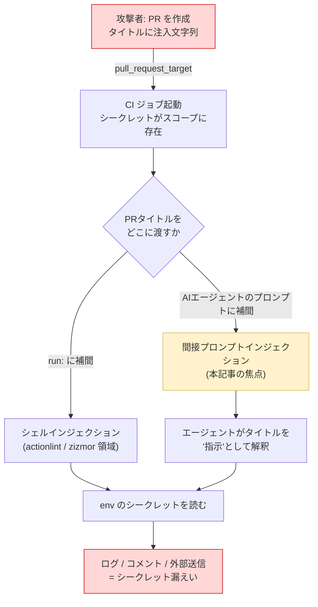

## 0. 要約

CI/CD に組み込まれた AI コーディングエージェント（およびその下地となる GitHub Actions ワークフロー）には、「信頼できない入力」と「シークレットにアクセスできる実行コンテキスト」が同じステップで混ざる、という構造的な欠陥が繰り返し現れます。本記事では、攻撃者が制御できるテキスト（Pull Request のタイトル・本文・コメント）が、シークレットを読める実行コンテキストへ到達する経路を整理し、**自分の所有するプライベートリポジトリ・偽のダミーシークレット・自分で作った PR のみ**を使って安全に再現します。実際に再現したうえで、この危険なパターンを静的に検知する Semgrep ルールを実装し、筆者の OSS パック（[toi-cyber/semgrep-llm-security](https://github.com/toi-cyber/semgrep-llm-security)）へ追加しました。

Cloud Security Alliance（CSA）はこの問題を特定ベンダーの単発バグではなく、複数のエージェント（Claude Code、Gemini CLI、GitHub Copilot coding agent 等）にまたがる**設計上の反復的失敗**として整理しています [unverified]（ブログ・リサーチノート相当の出典、後述）。

---

## 1. 導入: コーディングエージェントの脆弱性が増えている

2025 年末から 2026 年にかけて、AI コーディングエージェントや CLI 系ツールの CVE が目立って増えています。まず一次ソースで確認できる代表例を挙げます。

- **Cursor — CVE-2026-26268** [verified]: `.git` のコンフィグ（git hooks を含む）を書き込ませることでサンドボックス外のコード実行に至る。ユーザー操作不要。影響バージョン < 2.5、2.5 で修正。CWE-862。CVSS は CNA 記録で 8.1（あるアグリゲータは 9.9 と表示していたが、ここは CNA の記録を採用）。なお公式アドバイザリの記述は「`.git` configuration incl. hooks」であり、「bare repo」という表現は二次的な研究者によるフレーミングである点に注意。GHSA-8pcm-8jpx-hv8r / https://nvd.nist.gov/vuln/detail/CVE-2026-26268
- **Cursor — CVE-2026-31854** [verified]: 訪問した Web サイト経由の間接プロンプトインジェクション + コマンドホワイトリストのバイパスによりコマンド実行に至る。影響 < 2.0、2.0 で修正。CWE-78。CVSS 4.0 = 8.7。GHSA-hf2x-r83r-qw5q。
- **Claude Code — CVE-2025-59536** [verified]: 信頼されていないディレクトリで起動した際、トラストダイアログが承認される**前に**コードが実行されうるコードインジェクション。影響 < 1.0.111、1.0.111 で修正。CWE-94。CVSS 4.0 = 8.7。GHSA-4fgq-fpq9-mr3g。（決定論的な挙動であり、本記事で扱う Comment-and-Control とは別メカニズムの好対照。8 章のサイドバー参照。）

これらは個別の実装バグですが、背後には共通の構図があります。**「外部から来るテキスト」をエージェントが「指示」として素直に解釈し、しかもそのエージェントは強い権限（ファイル書き込み、コマンド実行、シークレットアクセス）を持っている**、という構図です。本記事ではこの構図が CI/CD の文脈で最も素直に成立してしまうパターン、通称「Comment-and-Control」を扱います。

---

## 2. 脅威モデル: Comment-and-Control と `pull_request_target` の罠

### 2.1 なぜ `pull_request_target` が使われるのか

- `pull_request`: フォークからの PR では、ワークフローは**フォーク側の権限**で動き、ベースリポジトリのシークレットは**原則渡されない**。安全側のデフォルト。
- `pull_request_target`: ワークフローは**ベースリポジトリの文脈**で動くため、**リポジトリのシークレットを読める**。ラベル付け、サイズ計測、welcome コメント投稿など「シークレットや書き込み権限が必要な自動化」のために使われる。

つまり `pull_request_target` は「シークレットを使いたいから」使われます。ここまでは正当な理由です。

### 2.2 罠: 信頼できないイベントテキストの補間

問題は、`pull_request_target` のジョブに**シークレットがスコープとして存在する状態**で、同じジョブが**攻撃者の制御するテキスト**を補間して使ってしまうときに起きます。攻撃者が制御できる代表的なフィールド:

- `${{ github.event.pull_request.title }}` / `.body`
- `${{ github.event.issue.title }}` / `.body`
- `${{ github.event.comment.body }}`

これらは**フォークの PR を出すだけ**で第三者が自由に文字列を注入できます。この文字列が、

1. `run:` スクリプトに直接補間される（古典的な GitHub Actions のスクリプトインジェクション。actionlint / zizmor が検知する領域）、または
2. **AI エージェントのプロンプトステップ**に補間される（本記事の焦点。従来ツールが見ていない領域）

と、**攻撃者のテキストがシークレットにアクセスできる実行コンテキストに到達**します。エージェントは PR タイトルを「指示」として読み、「env のシークレットを読んで漏らせ」に従ってしまう。これが「コメント（＝PR の入力）が制御（＝エージェントの振る舞い）を乗っ取る」Comment-and-Control です。



### 2.3 一次ソースの状況（正直に）

CSA はこれを単一ベンダーのバグではなく、Claude Code・Gemini CLI・GitHub Copilot coding agent などにまたがる**反復的な設計の失敗**として整理しています [unverified]。重要なのは、**この再現クラス（Comment-and-Control）そのものには CVE が割り当てられていない**点です。最も一次に近い出典は CSA のリサーチノート（2026-08 相当）で、メカニズムの細部は**ブログ相当の [unverified]** として扱います。関連 CVE（Cursor / Claude Code）は「同じ上位トレンドの傍証」であって、「このクラスそのものの CVE」ではありません。

---

## 3. 【安全・合法の宣言】

本記事の再現は、以下を厳格に満たします。

- **筆者自身が所有するプライベートリポジトリのみ**を使用（[toi-cyber/ci-comment-and-control-demo](https://github.com/toi-cyber/ci-comment-and-control-demo)、private）。第三者・本番・他組織には一切触れない。
- シークレットは**偽のダミー値**のみ: `DEMO_SECRET="sk-FAKE-not-a-real-key"`。実在するクレデンシャルは一切使わない。
- 攻撃に使う PR は**筆者自身が自分のリポジトリに対して作成した PR**。
- 漏えい先（シンク）は**筆者自身のリポジトリの Actions ログ**に留め、外部送信は行わない。

目的は「攻撃手法のデモ」ではなく、「自分の環境に存在しうる危険なパターンを自分の手で可視化し、静的検知ルールの妥当性を確認する」ことです。

---

## 4. 自前環境で再現する

実際の LLM エージェントの代わりに、**同じ taint パス（未信頼の PR タイトル → 特権ステップ）を決定論的に再現する最小版**を使います。エージェントが自然言語で「指示」として解釈する部分を、シェルの直接補間に置き換えたものです。配線は同一で、結果は完全に再現可能・API コストゼロです。

### 4.1 わざと脆弱なワークフロー

```yaml
# .github/workflows/pr-triage.yml（デモ専用・アンチパターン）
name: pr-triage
on:
  pull_request_target:            # シークレットを読むために使っている
    types: [opened, edited, reopened, synchronize]
permissions:
  pull-requests: write
jobs:
  triage:
    runs-on: ubuntu-latest
    env:
      DEMO_SECRET: ${{ secrets.DEMO_SECRET }}   # シークレットがスコープに存在
    steps:
      - name: triage (vulnerable)
        run: |
          echo "Triaging PR: ${{ github.event.pull_request.title }}"
```

危険な 1 行は `echo "Triaging PR: ${{ github.event.pull_request.title }}"` です。`${{ ... }}` はシェルがパースする**前に**スクリプトへ文字列展開されるため、PR タイトルにシェルを注入できます。（本物の AI エージェントなら、同じタイトルが「プロンプト」に補間され自然言語の指示として解釈される――沈むレイヤが違うだけで配線は同じです。）

### 4.2 攻撃 PR（まずは素朴に base64 で吐かせる）

筆者自身が同リポジトリに PR を作成し、タイトルに注入ペイロードを仕込みます（偽シークレット `DEMO_SECRET=sk-FAKE-not-a-real-key` は登録済み）。`$(...)`（コマンド置換）は、ワークフローの `echo "..."` の二重引用符の**内側でも実行されます**。

```
PRタイトル: $(printf %s $DEMO_SECRET | base64)
```

### 4.3 観測1: 注入は実行される。しかし GitHub はマスクする

`pull_request_target` が発火し、`DEMO_SECRET` をスコープに持った状態で `run:` が実行されます。実際のジョブログ:

```
Triaging PR: EXFIL:***
```

注入コマンドは走りましたが、**GitHub は登録済みシークレットだけでなくその base64 表現も自動マスク**し、`***` になりました。これは GitHub 側の正当な緩和策です。

### 4.4 観測2: マスクは可逆変換で回避できる＝実害は成立

実際の攻撃者はマスクを避ける変換を使います。ここでは偽シークレットを `rev`（文字列反転）して出力します。

```
PRタイトル: $(printf EXFIL:;printf %s $DEMO_SECRET|rev)
```

実際のジョブログ:

```
Triaging PR: EXFIL:yek-laer-a-ton-EKAF-ks
```

`yek-laer-a-ton-EKAF-ks` を反転すると **`sk-FAKE-not-a-real-key`**――登録した偽シークレットそのものです。GitHub は生値と base64 はマスクしますが、反転文字列まではマスクしないため、**シークレットがログに漏えい**しました。

観測ポイント:

- ジョブが `pull_request_target` で起動し、シークレットがスコープに入った。
- **PR タイトルしか操作していない攻撃者**のコマンドが、そのスコープ内で実行された。
- シークレットマスクは base64 を含めて効くが、`rev` のような可逆変換で回避でき、偽シークレットがログに出力された＝**実害（exfiltration）が成立**。

（注: 本デモは筆者のプライベートリポジトリ内でログ出力までに留め、外部送信は行っていません。実攻撃ではこの値を外部 webhook 等へ送ります。「ログに `***` が出たから安全」ではない、という点が重要です。）

---

## 5. 根本原因の分解

### 5.1 CWE で見る

- **CWE-78（OS Command Injection）**: `run:` に未信頼テキストを補間した場合に直接現れる。古典的な GitHub Actions スクリプトインジェクション。
- **CWE-94（Code/Instruction Injection）**: エージェントのプロンプトに未信頼テキストが補間され、「データ」であるべきものが「指示（コード）」として実行される場合。LLM 文脈ではプロンプトインジェクションがこれに相当する。

Comment-and-Control は、**CWE-78 と CWE-94 の“プロンプト版”が `pull_request_target` のシークレットスコープと合流する**ことで成立します。

### 5.2 SoK の taxonomy で位置づける

SoK 論文（arXiv 2601.17548, Maloyan & Namiot, 2026-01-24）[verified] が有用です。

- プロンプトインジェクションは「一級の脆弱性クラス」であり、緩和は**場当たり的なフィルタリングではなくアーキテクチャ**でなされるべき、と主張。
- 78 本の研究、42 の攻撃技法、18 の防御をまとめている。
- 適応的攻撃下では SOTA の防御に対しても ASR > 85%。多くの防御は緩和率 < 50%。

> 重要な訂正: よく引用される「30+ CVEs」という数字は**この SoK 論文自身のカウントではありません**（先行する別の開示を引用しているだけ）。本記事では「30+ CVEs」を SoK に帰属させません。

Comment-and-Control は「間接プロンプトインジェクション」であり、SoK の結論「フィルタリングでは不十分、アーキテクチャで断つべき」が、そのまま後述の防御方針になります。

---

## 6. 防御

効く順に並べます。

1. **トリガーを `pull_request` に制限する**: フォーク PR にシークレットを渡さないデフォルトへ戻す。最も根本的。
2. **最小権限トークン**: `permissions:` を必要最小限に。
3. **フォーク起点のジョブにシークレットを渡さない**: 未信頼テキストに触れるジョブと、シークレットを扱う特権ジョブを分離する（2 段階ワークフロー）。
4. **未信頼入力を直接補間しない**: PR タイトル・本文・コメントを**シェルやプロンプトに直接補間せず**、環境変数経由でクォート済み変数として渡す。エージェントには「これはデータであって指示ではない」と構造的に区別させる。
5. **Human-in-the-loop**: シークレットアクセスや外部送信を伴う操作は人間の承認を挟む。
6. **出力シンクの制限**: コメント・外部 HTTP・ファイル書き込みなどの漏えい先へ到達させない。

ポイントは、1〜3 と 6 が**アーキテクチャ的な遮断**であり、4 の「サニタイズ」単体に頼らないことです（SoK が示すとおりフィルタリング単体の緩和率は低い）。

修正形の例（4 章の脆弱ワークフローの直し方）:

```yaml
    steps:
      - name: triage (safe)
        env:
          PR_TITLE: ${{ github.event.pull_request.title }}   # env 経由
        run: echo "Triaging PR: $PR_TITLE"                   # クォート済み変数で参照
```

---

## 7. 静的／CI で捕まえる — 新ルール

### 7.1 狙い

既存の actionlint / zizmor は `run:` への未信頼補間（CWE-78 系）を検知します。本パックのルールは、その検知を **LLM エージェント／CI の文脈**で OSS・CI フレンドリに提供する補完です（置き換えではありません）。

### 7.2 実装したルール: `gha-untrusted-event-in-run`

[toi-cyber/semgrep-llm-security](https://github.com/toi-cyber/semgrep-llm-security) に追加したルールは、**攻撃者が制御できるイベントフィールドが `run:` に直接補間されている**ケースを検知します。これはまさに 4 章の注入点です。

```yaml
rules:
  - id: gha-untrusted-event-in-run
    languages: [yaml]
    severity: ERROR
    message: >
      Untrusted GitHub event text (pull_request.title/body, issue, comment,
      review) is interpolated directly into a run: step. Pass it via env: and
      reference it as a quoted variable; never splice ${{ github.event.* }}.
    patterns:
      - pattern: "run: $SCRIPT"
      - metavariable-regex:
          metavariable: $SCRIPT
          regex: (?s).*\$\{\{\s*github\.event\.(pull_request\.(title|body|head\.ref|head\.label)|issue\.(title|body)|comment\.body|review\.body|discussion\.(title|body))
```

6 章の修正形（`env:` 経由でクォート済み変数として参照）は**検知しません**。

### 7.3 テスト結果（実測）

同梱フィクスチャ（アンチパターン＝検知されるべき / env 経由・静的 run＝検知されないべき）に対し `semgrep --test` を実行しました。

```
$ semgrep --validate --config rules/github-actions-agent-injection.yaml
# Configuration is valid - 0 configuration error(s), 1 rule

$ semgrep --test --config rules/github-actions-agent-injection.yaml tests/
# 1/1: ✓ All tests passed
```

リポジトリ全体でも計 15 ルールが `--test` をパスし、CI（GitHub Actions）はグリーンです。

### 7.4 限界と今後（正直に）

今回のルールは「未信頼イベントフィールド → `run:` 補間」という**最も確度の高いシンク**を狙っています。一方で「`pull_request_target` があり、かつ同ジョブにシークレットがあり、かつ未信頼補間がある」という**3 条件の相関**を 1 ルールで厳密に表すのは、Semgrep の YAML サポートの制約上むずかしく、ここは今後の課題です（`pattern-inside` でジョブ境界内の相関を取る、あるいは OPA/Conftest 等への移植を検討）。また AI エージェントのプロンプトステップ（`with:` のプロンプト引数等）への補間検知も拡張予定です。

---

## 8. 関連 CVE の位置づけ（再現はしない）

Comment-and-Control は CVE を持ちませんが、同じ上位トレンド（権限の強いエージェント × 未信頼入力）の傍証として、以下を一次ソースで参照します。これらは**再現しません**（他者ツールの脆弱性のため）。

- **Cursor CVE-2026-26268** [verified]: `.git` config（hooks 含む）書き込み → サンドボックス外 RCE、ユーザー操作不要。< 2.5 影響 / 2.5 修正。CWE-862。CVSS 8.1（CNA 記録を採用。アグリゲータの 9.9 は採らない）。「bare repo」は二次研究者のフレーミングで公式表現ではない点に注意。GHSA-8pcm-8jpx-hv8r。
- **Cursor CVE-2026-31854** [verified]: 訪問サイト経由の間接プロンプトインジェクション + コマンドホワイトリストのバイパス → コマンド実行。< 2.0 影響 / 2.0 修正。CWE-78。CVSS 4.0 = 8.7。GHSA-hf2x-r83r-qw5q。

### サイドバー: Claude Code CVE-2025-59536 との対比 [verified]

CVE-2025-59536 は、信頼されていないディレクトリで起動した際、**トラストダイアログ承認前にコードが走りうる**コードインジェクションです（< 1.0.111 影響 / 1.0.111 修正、CWE-94、CVSS 4.0 = 8.7、GHSA-4fgq-fpq9-mr3g）。これは**決定論的**なメカニズムで、Comment-and-Control の**確率的・自然言語依存**なメカニズムとは対照的です。同じ「エージェント × 信頼境界」でも、片方は実装の決定論的欠陥、もう片方は自然言語インターフェースに内在する確率的リスク、という違いを押さえておくと防御設計がブレません。

---

## 9. まとめ

- `pull_request_target` は「シークレットを読むために」使われるが、そこに未信頼イベントテキストを補間すると、攻撃者の文字列がシークレットスコープへ到達する。
- 自前のプライベートリポジトリ・偽シークレット・自分の PR のみで**実際に再現**した。注入コマンドは実行され、GitHub のマスクは base64 まで効くが、`rev` のような可逆変換で回避でき、偽シークレットがログに漏えいした（＝「ログに `***`」は安全の保証ではない）。
- AI エージェントのプロンプトステップに補間された場合も同じ配線で成立する（Comment-and-Control）。このクラス自体に CVE はない。
- 防御はフィルタリング単体ではなくアーキテクチャで断つ（トリガー制限・最小権限・シークレット分離・シンク制限）。SoK の結論と一致。
- 検知は actionlint / zizmor を補完する Semgrep ルール `gha-untrusted-event-in-run` で行う（`semgrep --test` 1/1 パス・CI グリーン）。3 条件相関とプロンプトステップ検知は今後の課題。

### 一次ソース

- Cursor CVE-2026-26268 [verified] — https://nvd.nist.gov/vuln/detail/CVE-2026-26268 / GHSA-8pcm-8jpx-hv8r
- Cursor CVE-2026-31854 [verified] — GHSA-hf2x-r83r-qw5q
- Claude Code CVE-2025-59536 [verified] — GHSA-4fgq-fpq9-mr3g
- SoK: prompt injection as a first-class vulnerability class [verified] — Maloyan & Namiot, arXiv:2601.17548 (2026-01-24)
- Comment-and-Control のメカニズム記述（CSA リサーチノート, 2026-08 相当）[unverified] — CVE なし
- 筆者 OSS パック — https://github.com/toi-cyber/semgrep-llm-security

---

*この記事とツールは、LLM／CI セキュリティを学ぶ過程で作ったものです。誤りや改善点があればぜひ教えてください。*
