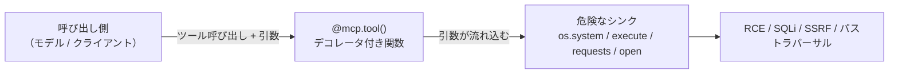
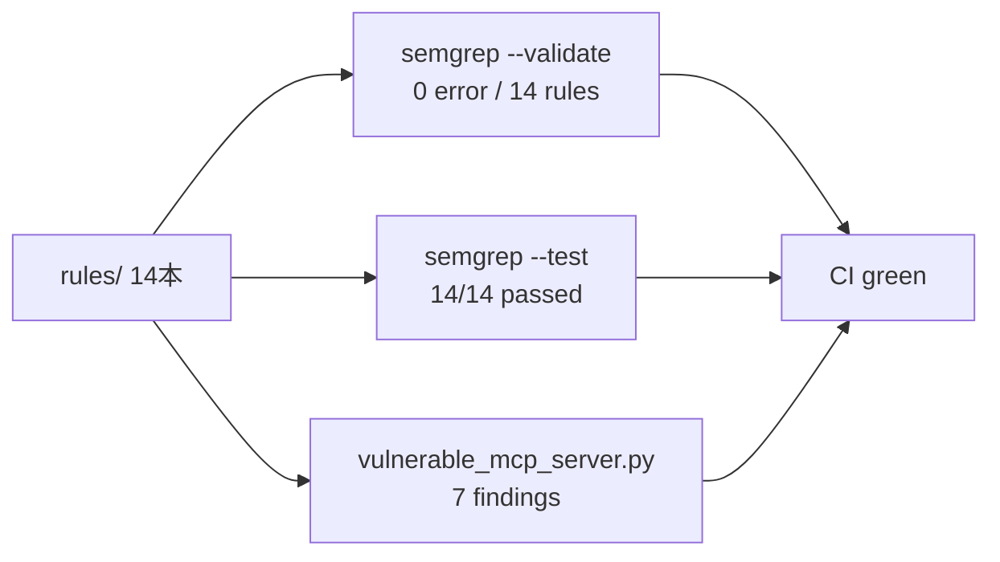

> この記事で作るもの: MCP（Model Context Protocol）サーバのソースコードを読んで、危険な実装を自動で指摘する Semgrep ルール集を紹介します。既存の LLM アプリ向けルール集 [semgrep-llm-security](https://github.com/toi-cyber/semgrep-llm-security) に 7 本の MCP サーバ用ルールを追加し、合計 14 本になりました。すべて実際に動かして検証したところまで載せます。

## 1. 導入：MCPの普及と「ツール」という攻撃面

MCP（Model Context Protocol）は、LLM に外部のデータやツールを繋ぐための共通プロトコルとして、この 1 年で一気に普及しました。Claude、各種 IDE、エージェントフレームワークが MCP サーバを読み込み、ファイル操作・DB クエリ・HTTP リクエスト・シェル実行などを「ツール」として呼び出します。

ここで静かに増えているのが、**MCP サーバそのものの実装脆弱性**です。多くの人はプロンプトインジェクションのような「モデル側の問題」を想像しますが、実際に最初に刺さるのは、もっと古典的で地味な穴です。MCP サーバのツールは**引数を受け取る普通の関数**であり、その引数は呼び出し側（＝攻撃者が影響を及ぼせる経路）が制御します。つまり、

> **ツール引数が危険なシンクに届いたら、それは攻撃者制御の値が危険なシンクに届いたのと同じ**

です。RCE・SQLi・SSRF・パストラバーサル──どれも新しい攻撃ではなく、**古典的な Web 脆弱性が「MCP ツール」という新しいチャネル経由で蘇ったもの**です。だからこそ、従来のセキュリティ知識と静的解析がそのまま効きます。

本記事では、この「ツール引数＝攻撃者制御の入力」という観点を Semgrep の taint（汚染追跡）モードに落とし込み、実際に検出できるところまでを示します。

## 2. MCPツール＝デコレータ付き関数の構造

MCP Python SDK では、ツールは `@mcp.tool()` デコレータを付けた関数として定義します [verified]。ツールの説明文（description）はデフォルトで関数の docstring から取られ、サーバは `stdio` / `streamable-http` / `sse` といったトランスポートで起動します [verified]。

```python
from mcp.server.fastmcp import FastMCP

mcp = FastMCP("ops-helper")

@mcp.tool()
def get_order(order_id: str) -> str:
    """Look up an order by id."""   # これが description になる
    ...

if __name__ == "__main__":
    mcp.run(transport="stdio")
```

重要なのは、`order_id` のような引数が**どこから来るか**です。MCP では、どのツールをどんな引数で呼ぶかを決めるのは最終的にモデル（あるいはそのツールを叩く任意のクライアント）です。開発者から見れば、ツール引数は「信頼できない外部入力」として扱うべきもの──Web でいえば `request.args.get()` と同じ位置づけです。



この図の「引数 → シンク」の経路こそ、ソースコードに必ず現れる「危険な配線」です。

## 3. OWASP MCP Top 10（Beta）と静的に捕まる範囲の線引き

攻撃面を整理する枠組みとして、OWASP は **MCP Top 10** を公開しています（ただし現時点では **Beta** で、ID や項目は今後変わりうる点に注意）[verified]。

MCP 向けの防御研究である MCPGuard（arXiv 2510.23673）は、軽量な**静的パターンマッチを第一段**に据える多段構成を提案しています [verified]。本記事の Semgrep ルールは、この「静的な第一段」を、CI に組み込める形でオープンに実装したものと位置づけられます。

では、MCP の脅威のうち**どこまでが静的解析で捕まるのか**。線引きを先に示します。

| 脅威カテゴリ | 代表例 | 静的に捕まるか |
|---|---|---|
| コマンド/コード実行、SQLi、SSRF、パストラバーサル | ツール引数 → 危険なシンク | **捕まる**（配線がコードに出る） |
| 認証・認可の不足 | ネットワーク公開＋認証なし | **一部**（公開の設定面は捕まる） |
| シークレット露出 | ソースへのキー直書き | **捕まる**（リテラルの形で出る） |
| ツールポイズニング | 悪意ある description | **surface のみ**（動的な説明文の存在は捕まるが「悪意かどうか」は判定不可） |
| SDK 内部の実装バグ | OAuth 資格情報の扱いの欠陥 | **捕まらない**（依存バージョン検査の領分） |

この表の「捕まる／捕まらない」の境界は、後半の第 8 章で改めて正直に掘り下げます。まずは「捕まる」側を、実際の CVE と研究で裏打ちしていきます。

## 4. 実CVEに学ぶ：Grafana SSRF と DB-MCP の未認証公開

ルールを「ありそうな話」で終わらせないために、実在の脆弱性に紐づけます。

### Grafana MCP の SSRF（SSRF ルールの原型）

Grafana の MCP 実装には SSRF の脆弱性が報告されています（**CVE-2026-19516、CVSS 9.1**）[verified]。ツールに渡された URL をそのまま外向きリクエストの宛先に使うと、呼び出し側は内部アドレスやクラウドのメタデータエンドポイントに到達できてしまう──これがそのまま `mcp-tool-arg-ssrf` ルールの原型です。

### 未認証で公開された DB-MCP の RCE（トランスポート/認証ルールの動機）

データベース系の MCP サーバが**認証なしでネットワークに公開**され、結果として RCE に至るケースが複数報告されています。MySQL MCP（CVE-2026-59971）、mcp-pinot（CVE-2026-49257）、Apache Doris MCP（CVE-2025-66335 / CVE-2025-66336）などです（いずれも脆弱性アグリゲータ経由で確認したもので、個別の詳細は一次情報での確認を推奨します）[unverified]。

共通する構図は単純で、「強力なツールを持つサーバを、認証なしに `0.0.0.0` で待ち受けた」。これが `mcp-http-transport-exposed` ルールの動機です。

## 5. MCPToxが示すTool Poisoning ── 静的に「何が」捕まるか

ツールポイズニングは MCP 特有の攻撃として注目されています。実証研究 **MCPTox（arXiv 2508.14925）** は、45 サーバ・353 ツール・1312 ケースを対象に評価し、平均の攻撃成功率（ASR）は約 36.5%、最大で約 72.8% に達したと報告しています [verified]。

この研究で特に重要な知見が 2 つあります。

1. 攻撃経路は、ツールの**説明文（description）というメタデータ**に仕込まれる。モデルは登録時にツールの説明を「信頼できる指示」として読むため、そこに悪意ある指示を混ぜると乗っ取れる [verified]。
2. 一方で、素朴なプロンプトインジェクションのペイロードでは ASR はほぼ 0% であり、専用に設計されたベンチマークが必要だった [verified]。

（なお同論文は、リスク項目の数について本文中で 10 と 11 の記述が混在しており、数え方は確定的ではありません。ここでは断定を避けます。）

ここが静的解析との線引きのキモです。**「ある static な説明文が悪意あるものかどうか」は、コードを読んでも判定できません。** それは実行時・モデル側の問題です。

静的に捕まえられるのは、**説明文が動的に組み立てられているという surface（攻撃面の存在）**だけです。説明文がリテラルではなく、f-string・変数・環境変数などから作られていれば、そこは外部データが混入しうる「ツールポイズニングの入り口」になりえます。だから `mcp-tool-dynamic-description` は「悪意判定」ではなく「動的な説明文の存在を指摘する」ルールとして割り切っています。

## 6. Semgrepルール：taint 4本 + pattern 3本

作ったのは 7 本です。ツール引数を汚染源とする taint ルール 4 本と、設定・定義の smell を見る pattern ルール 3 本に分かれます。

| ルール ID | 検出するもの | 深刻度 | OWASP MCP |
|---|---|---|---|
| `mcp-tool-arg-command-injection` | 引数 → `os.system`/`subprocess shell=True`/`eval`/`exec`/`os.popen`（RCE） | ERROR | MCP05 |
| `mcp-tool-arg-sql-injection` | 引数 → 連結された SQL（SQLi） | ERROR | MCP05 |
| `mcp-tool-arg-ssrf` | 引数 → `requests`/`httpx`/`urllib` の URL（SSRF） | WARNING | MCP05 |
| `mcp-tool-arg-path-traversal` | 引数 → `open()` のパス（パストラバーサル） | WARNING | MCP05 |
| `mcp-tool-dynamic-description` | 非リテラルから作られた description（ポイズニング surface） | WARNING | MCP03 |
| `mcp-http-transport-exposed` | `0.0.0.0` にバインドした network transport（認証なし公開） | WARNING | MCP07 |
| `mcp-hardcoded-secret` | ソース直書きのシークレット（`sk-…`/`ghp_…`/`AIza…` 等） | WARNING | MCP01 |

### taint の肝：汚染源をツール引数に絞る

4 本の taint ルールは、すべて同じテクニックを使います。既存の LLM 出力ルールでは「LLM の出力」を汚染源にしていましたが、MCP ルールでは**汚染源を「`@mcp.tool()` デコレータ付き関数の引数」に絞り込みます**。この汚染源スコープが Semgrep の taint モードで正しく効くことは、ルールを本実装する前に PoC で検証済みです。

実際の SQLi ルールの定義はこうです。

```yaml
- id: mcp-tool-arg-sql-injection
  mode: taint
  languages: [python]
  severity: ERROR
  pattern-sources:
    - patterns:
        - pattern: |
            @$MCP.tool(...)
            def $F(..., $SRC, ...):
                ...
        - focus-metavariable: $SRC      # ツールの引数だけを汚染源にする
  pattern-sinks:
    - patterns:
        - pattern-either:
            - pattern: $CUR.execute($Q, ...)
            - pattern: $CUR.execute($Q)
        - focus-metavariable: $Q         # クエリ文字列に汚染が入る時だけ
```

ポイントは 2 つの `focus-metavariable` です。

- 汚染源側の `focus-metavariable: $SRC` で、「`@mcp.tool()` が付いた関数の引数」だけを汚染源として扱う。
- シンク側の `focus-metavariable: $Q` で、「`execute()` の第 1 引数（クエリ文字列）に汚染が届いた時だけ」に絞る。

この結果、**バインドパラメータ（第 2 引数）経由の安全なクエリは誤検知しません**。同じ `cursor.execute()` でも、危険な使い方だけを狙い撃ちにできます。

### 脆弱 vs 安全：1 ツールの対比

```python
# NG: ツール引数をそのまま SQL 文字列へ → SQLi。警告が出る
@mcp.tool()
def get_order(order_id: str) -> str:
    """Look up an order by id."""
    cur.execute("SELECT * FROM orders WHERE id = '%s'" % order_id)
    return str(cur.fetchone())

# OK: ツール引数はバインドパラメータとして渡す → 警告は出ない
@mcp.tool()
def get_order(order_id: str) -> str:
    """Look up an order by id."""
    cur.execute("SELECT * FROM orders WHERE id = ?", (order_id,))
    return str(cur.fetchone())
```

SSRF ルールとパストラバーサルルールには、それぞれ `validate_url()` / `validate_path()` をサニタイザとして登録してあります。入力がこのバリデータを通れば汚染がクリアされ、警告が消えます。「安全な書き方を誤検知しない」ことは、CI に組み込むツールとしての実用性を決める部分です。

### pattern ルール側

残り 3 本は taint ではなくパターンで見ます。たとえば動的 description の検出は、「description に何か渡っている」かつ「それがリテラル文字列ではない」という形です。

```yaml
- id: mcp-tool-dynamic-description
  patterns:
    - pattern: "@$MCP.tool(..., description=$X, ...)"
    - pattern-not: '@$MCP.tool(..., description="...", ...)'
```

ハードコードシークレットは `sk-…` / `ghp_…` / `AIza…` / `xox…` といった「シークレットの形をしたリテラル」を正規表現で拾います。トランスポート公開は `mcp.run(...)` が `transport="streamable-http"`（または `sse`）かつ `host="0.0.0.0"` のケースを見ます。

## 7. 実行結果：14/14 と 7 検出

主張は控えめに、事実だけを並べます。

**構文検証：**

```
$ semgrep --validate --config rules/
# 0 configuration error(s)、14 rules
```

**自動テスト（誤検知テストを含む）：**

```
$ semgrep --test --config rules/ tests/
# 14/14 passed
```

このテストには、**正しく検出しないことを確認する**ケースも含まれます。バインドパラメータの SQL、`validate_url()` 通過後の fetch、`validate_path()` 通過後の open、そして static な（リテラルの）description は、いずれも**正しく無警告**になることを確認しています。

**わざと脆弱なデモサーバの走査：**

リポジトリには `examples/vulnerable_mcp_server.py` を同梱しています。各ツールが 1 つずつ別の穴を体現する構成です。

```python
API_KEY = "sk-abcdefghijklmnop1234567890"     # (secret) 直書き

@mcp.tool()
def ping(host: str) -> str:                    # (command injection)
    return os.popen("ping -c1 " + host).read()

@mcp.tool()
def get_order(order_id: str) -> str:           # (SQL injection)
    cur.execute("SELECT * FROM orders WHERE id = '%s'" % order_id)
    ...

@mcp.tool()
def fetch_metrics(url: str) -> str:            # (SSRF)
    return requests.get(url).text

@mcp.tool()
def read_log(path: str) -> str:                # (path traversal)
    with open(path) as f:
        return f.read()

@mcp.tool(description=f"Query the {os.environ.get('BACKEND','prod')} backend")
def query_backend(q: str) -> str:              # (tool poisoning surface)
    return q

if __name__ == "__main__":
    mcp.run(transport="streamable-http", host="0.0.0.0", port=8000)  # (exposed)
```

これを走査すると、**7 件の検出**──各ルールのカテゴリにつき 1 件ずつ──が得られます。

```
$ semgrep --config rules/ examples/vulnerable_mcp_server.py
# 7 findings: command-injection / sql-injection / ssrf /
#             path-traversal / dynamic-description /
#             http-transport-exposed / hardcoded-secret
```

CI（GitHub Actions）もグリーンです。



## 8. 検出できない＝正直な限界

ここが本記事で最も大事な節です。静的解析が**できないこと**を明示しておきます。

**(a) ツールポイズニングの本体は静的には判定できない。** サードパーティの MCP サーバが仕込んだ悪意ある指示や、「ある static な説明文が悪意あるものか」という判断は、実行時・モデル側の問題です。コードを読んでも分かりません。静的に捕まるのは、前述のとおり**説明文が動的に組み立てられているという surface のみ**です。

**(b) SDK 内部のバグは別のレイヤの問題。** MCP Python SDK の OAuth 資格情報の扱いに関する欠陥（**GHSA-qx49-fqc8-xw99 / CVE-2026-115563**）[unverified] のようなものは、利用者のコードパターンではなく SDK 内部のバグです。これは**依存関係・バージョン検査**（SCA / Dependabot 等）の領分であり、コードパターンルールでは捕まえるべきではありません。役割を混ぜないことが、ツールの誠実さだと考えています。

**(c) OWASP MCP Top 10 はまだ Beta。** 項目や ID（MCP01〜MCP07 など本記事で引用したもの）は今後ずれる可能性があります。ルールのメタデータも、確定後に追従する前提です。

**(d) これはソースレベルのヒューリスティックであって、安全性の証明ではない。** 共通の危険な配線は捕まえますが、ルールに登録していない SDK・ライブラリ・書き方は取りこぼします。カバレッジの拡大がそのまま貢献になる、という設計です。

動的な MCP レッドチーム（MCPTox が示すような実行時の攻撃評価）とは**補完関係**です。本記事のアプローチは、その 1 歩手前のソースコード／CI で、古典脆弱性の「配線」を潰すことに特化しています。

## 9. まとめ

- MCP ツールは `@mcp.tool()` を付けた**普通の関数**で、その引数は**呼び出し側＝攻撃者が影響できる外部入力**。
- だから「ツール引数 → 危険なシンク」は、**古典 Web 脆弱性（RCE / SQLi / SSRF / パストラバーサル）が MCP 経由で蘇ったもの**。従来のセキュリティ知識と静的解析がそのまま効く。
- Semgrep の taint モードで**汚染源をツール引数に絞る**ことで、危険な配線だけを狙い撃ちにし、安全な書き方（バインドパラメータ、バリデータ通過）は誤検知しない。
- 実測で `--validate` 0 error / 14 rules、`--test` 14/14 passed、デモサーバ 7 検出、CI グリーン。
- 一方で、ツールポイズニングの本体・SDK 内部バグは静的解析の外。役割を混同しないことが重要。

ルール集はこちら（MIT・Issue / PR 歓迎）：https://github.com/toi-cyber/semgrep-llm-security

## 一次情報

- [OWASP MCP Top 10 (Beta)](https://owasp.org/www-project-mcp-top-10/) [verified]
- [MCPTox（arXiv 2508.14925）](https://arxiv.org/abs/2508.14925) [verified]
- [MCPGuard（arXiv 2510.23673）](https://arxiv.org/abs/2510.23673) [verified]
- [Grafana MCP SSRF: CVE-2026-19516（CVSS 9.1）](https://grafana.com/security/security-advisories/cve-2026-19516) [verified]
- 未認証 DB-MCP RCE: MySQL MCP (CVE-2026-59971) / mcp-pinot (CVE-2026-49257) / Apache Doris MCP (CVE-2025-66335, CVE-2025-66336) [unverified]（アグリゲータ経由・一次情報での確認を推奨）
- [MCP Python SDK](https://github.com/modelcontextprotocol/python-sdk) [verified]

---

*この記事とツールは、MCP／LLM アプリケーションセキュリティを学ぶ過程で作ったものです。誤りや改善点があればぜひ教えてください。*
